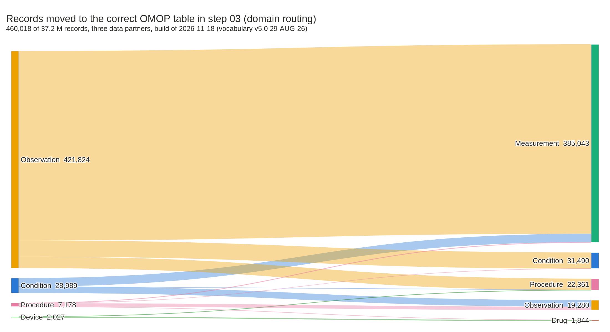

# Domain routing: records moved to the correct OMOP table

Of the 37.2 million clinical event records submitted by the three partners, 460,018 (1.2%) were moved from the table they were sent in into the correct OMOP table, based on the domain of their standard concept. Nearly all (92%) were observations whose concept is a measurement (368,187), a condition (31,489) or a procedure (22,148).



**Figure 1. Records moved to a different OMOP table in step 03**, by the table they were sent in and the table of their standard concept's domain (460,018 of 37.2 M records; three data partners; 2026-11-18 build, vocabulary v5.0 29-AUG-26). Device → Drug includes 1,791 chlorhexidine product records (correctly drugs) and 28 name-matched "lead" copies.

An interactive version is in [domain_routing_sankey.html](domain_routing_sankey.html) (download and open in a browser; hover over a band for its count).

## Records moved, by table sent in and final table

| Sent in | Moved to | Records |
|---|---|---:|
| Observation | Measurement | 368,187 |
| Observation | Condition | 31,489 |
| Observation | Procedure | 22,148 |
| Condition | Measurement | 16,302 |
| Condition | Observation | 12,682 |
| Procedure | Observation | 6,598 |
| Device | Drug | 1,819 |
| Procedure | Measurement | 554 |
| Device | Procedure | 208 |
| Procedure | Drug | 25 |
| Condition | Procedure | 5 |
| Procedure | Condition | 1 |
| **Total** | | **460,018** |

The remaining 36.7 M records (98.8%) stayed in the table they were sent in.

## How the counts were made

Step 03 (`03-prepared/03_all_domains.py`) writes, for every record, the domain of the site's concept (`source_domain_id`) and the domain of its standard concept after `Maps to`, the Meas Value rescue, the reviewed concept replacements and the no-map fallback (`target_domain_id`). Step 04 routes each record to the table of `target_domain_id`; a record whose target domain has no table (e.g. Meas Value, Geography, Unit, Episode) stays in the table it was sent in.

The counts come from the step 03 tables of all three sites (`<site>_ingestion.03_<table>` for condition_occurrence, procedure_occurrence, measurement, observation, drug_exposure and device_exposure), read-only:

```sql
SELECT sent_in,
       CASE WHEN target_domain_id IN ('Condition','Procedure','Measurement','Observation','Drug','Device','Visit')
            THEN target_domain_id ELSE sent_in END AS final_table,
       COUNT(*) AS n
FROM (  SELECT 'Observation' AS sent_in, target_domain_id FROM <site>_ingestion.03_observation
        UNION ALL ...                                      -- every table, every site
     ) s
GROUP BY 1, 2;
```

The chart was drawn with Plotly (`go.Sankey`): moved records only, one colour per OMOP table, bands coloured by the table sent in.

## Notes

- These are step 03 routing decisions; step 04 applies them. Per-site checks against the step 04 tables (`source_domain`) agree, apart from small removals in later pipeline steps.
- Moves follow the OMOP convention that the domain of the standard concept decides the table. Many reflect the current vocabulary's domain assignments, e.g. SNOMED findings such as BMI categories in the Condition domain, and administrative HCPCS codes (mainly G2211) in the Observation domain.
- The 28 "lead" records moved from Device to Drug are copies from one partner's name-based device mapping, a known issue addressed by a separate device correction.
