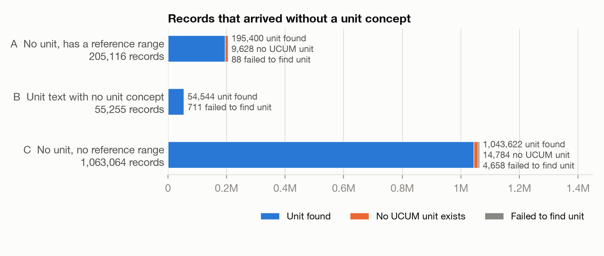
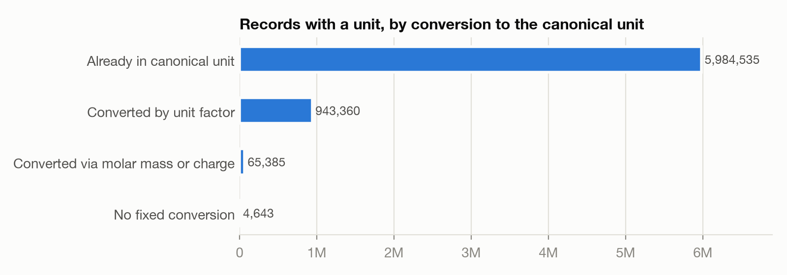

# Unit harmonization of AI-READI EHR measurements

Every numeric measurement record, by how it arrived and where it ended up:

| Arrived with | Records | Has a unit now | No UCUM unit exists | Failed to find unit |
|---|---:|---:|---:|---:|
| A unit concept | 5,704,371 | 5,704,371 | 0 | 0 |
| Unit text only | 55,255 | 54,544 | see below | 711 |
| No unit, reference range | 205,116 | 195,400 | 9,628 | 88 |
| No unit, no range | 1,063,064 | 1,043,622 | 14,784 | 4,658 |
| *Unit removed by a correction* | | -14 | | +14 |
| **Total** | **7,027,806** | **6,997,923** | **24,412** | **5,471** |

Counts are from the 2026-11-03 run. Counts under 11 aren't reported: the
unit-text group's no-UCUM records are counted under failed to find unit.

Of the 6,997,923 records with a unit, 6,993,280 (99.9%) are in their test's
canonical unit: 5,984,535 already were, and 1,008,745 were converted.

The method behind each count is in [Appendix A](#appendix-a-records-by-method).

## Where the results are

- `hive_metastore.ehr_union_clean_metrics.measurement_unit_harmonized` is a
  full copy of `ehr_union_clean.measurement` with added columns
  ([Appendix B](#appendix-b-added-columns)). The source table is unchanged.
- `measurement_unit_named` is that table with concept names and unit codes
  added (`measurement_concept_name`, `harmonized_concept_name`, `test_name`,
  `effective_unit_code`).
- `unit_mapping` says what unit each unit text means and which unit codes are
  wrong for which records, with the source and rationale of each. Its design
  is in [unit_mapping_design.md](unit_mapping_design.md).

## How a record's unit was decided

Records with no unit concept fall into three groups, each with its own
notebook. A, B and C run in that order, and D then converts every unit.

- **A. No unit, reference range.** Mostly copied from labeled records of the
  same test, accepted only if the medians agree within a factor of 2 (which
  keeps 98 °F from being called Celsius). An exact reference-range match is
  trusted as is.
- **B. Unit text, no unit concept.** Each trimmed text is looked up in
  `unit_mapping`. Automatic sources need no judgment: the text is a UCUM code,
  a unit label in the AI-READI REDCap lookup, the unit records with the same
  text arrived with, or a non-standard UCUM code OMOP maps to a standard one.
  Typed judgment rows, each with a rationale, cover the rest. Text whose
  sources disagree, or whose case variants mean different units (`s` second,
  `S` siemens), gets no unit and is listed for review.
- **C. No unit, no reference range.** Almost all flowsheet and exam data from
  one partner, mostly with no labeled records to copy from, so units come from
  rules on the test name (end-tidal CO2 in mm[Hg], tidal volume in mL, pain
  scores in [score]). C runs last because it uses A's and B's units as
  evidence.

`unit_mapping` also holds corrections: unit codes that are wrong for some
records, whatever set them (seconds coded as siemens, one partner's "lb" body
weights that are ounces). Every part sees records in their corrected unit, and
Part D writes it into the table.

`no_ucum_unit` is only for quantities UCUM has no unit for. Ratios, pH,
indexes, scores, fractions, multiples of the median and optical density have
UCUM units (`{ratio}`, `pH`, `{index}`, `[score]`, `{fraction}`, `{MOM}`,
`{ISR}`, `[OD'U]`), and get them.

## Conversion to a canonical unit

Each test gets one canonical unit: its most common unit, or one set by hand
for these tests:

| Test | Canonical unit |
|---|---|
| Body weight | kg |
| Body height | cm |
| Body temperature | Cel |
| HbA1c | % |
| 24 h urine protein | mg/(24.h) |
| Urine albumin | mg/dL, the REDCap list's unit |

Units convert by fixed factors (lb to kg, °F to °C, mg/L to mg/dL), and by
molar mass or ionic charge where the analyte is known (mEq/L to mmol/L for
sodium, potassium, chloride and bicarbonate). Mislabeled units were found by
comparing converted medians with those of records already in the canonical
unit, and are corrections in `unit_mapping`, applied before conversion.

## Records under the wrong concept

Every record keeps the `measurement_concept_id` it arrived with.
`harmonized_measurement_concept_id` holds the concept the harmonization uses:
the same one, except where `measurement_concept_corrections` replaces it. All
units, canonical units and conversions are per harmonized concept.

There is one correction: 3023884 "Cholesterol in HDL/Cholesterol.total [Mass
Ratio]" -> 3011163 "Cholesterol.total/Cholesterol in HDL". HDL/total can't
exceed 1, and all 6,464 records are above 1. The values are total/HDL and match
the same person's same-day total/HDL (probe F4).

## Plausibility

For tests on the AI-READI REDCap list, `value_plausibility` marks each
converted value as plausible, clinically extreme or implausible, using the
limits AI-READI set for the survey data (DataElementMaps'
[09_validate_units_and_value_ranges.sql](https://github.com/AI-READI/DataElementMaps/blob/main/redCapDataDictionaryWithExtension/value-set-mapping-common/scripts/09_validate_units_and_value_ranges.sql)).
Nothing is changed or removed, because the limits catch bad values with correct
units. A group of records (partner, test, unit) whose median is implausible
is listed for review instead, since that means the unit is wrong. None are
listed now.

## The rules, for review

These tables hold the rules behind the results, with no counts, medians or
partner ids. [G_rule_tables.sql](G_rule_tables.sql) produces them.

| Table | Rows | Contents |
|---|---:|---|
| [conversions.csv](tables/conversions.csv) | 77 | Every conversion applied |
| [canonical_unit_rules.csv](tables/canonical_unit_rules.csv) | 6 | Tests whose canonical unit is set by hand |
| [unit_corrections.csv](tables/unit_corrections.csv) | 38 | Unit codes that are wrong for some records |
| [unit_text_judgments.csv](tables/unit_text_judgments.csv) | 105 | Unit text mapped by a typed judgment row |
| [test_name_rules.csv](tables/test_name_rules.csv) | 48 | Part C's rules on the test name |
| [test_concept_rules.csv](tables/test_concept_rules.csv) | 38 | Part A's rules for a test concept |
| [source_name_rules.csv](tables/source_name_rules.csv) | 81 | Units for records with no test concept, by source test name |

Left out: `unit_factors` (149 rows; `conversions.csv` shows those used) and
value bands (8).

Every rule is a table in `ehr_union_clean_metrics`, and every record carries
`unit_inference_method`, so any assigned unit can be traced to the rule that
set it.

## Known issues

- **5,471 records where no unit was found:** codes and identifiers stored as
  numbers (3,789), small tests with no rule yet (650), unit text nothing maps
  (436), values that don't fit their test (307), junk unit text (275), and
  records a correction leaves with no unit (14).
- **4,643 records with a unit that can't convert:** arbitrary antibody units,
  log viral loads, and tests holding two quantities (1,440 PT values in
  seconds under INR, whose canonical unit is {ratio}).
- **Records stored twice:** one partner stores 4,067 events in 17 tests under
  two unit codes that differ only in case (`s` and `S`, `L` and `l`, `H` and
  `h`). Corrections give both copies the same unit, and both are kept.
  Deduplicating belongs upstream. Probes F6 and F7 in
  [F_probes.sql](F_probes.sql) find them.
- **Values that don't fit their test** are flagged and not converted: "total
  T4" that is free T4, or total lung capacity stored under the RV/TLC ratio.
  RBC counts under reticulocytes and HDL mass records that look like ratios
  are left as recorded.
- **Close canonical-unit calls:** CRP, testosterone, T3, radiation dose, and
  24 h urine urea nitrogen split between two units. RA/RV/LV lead pacing
  threshold, RV free wall S', tidal volume setting and ionized calcium hold
  two quantities, so no canonical unit covers both.
- **Corrections whose result still doesn't match the test's other records:**
  CEA, testosterone and expiratory minute volume (D's 17f), and 24 h urine
  protein (19e).
- **Records with no concept** that got a unit from a source name can't be
  checked against the list's limits, and have had no sign-off.
- **The REDCap list against our data:**
  - Urine albumin's limits are in mg/dL, and the survey values fit that unit.
    The upper limits sit far above nearly all EHR and survey values.
  - The list's uACR concept 3020682 has no EHR records. The data is under
    3034485 and 3001802.
  - `import_buncreatinineratio` holds creatinine/BUN in the survey data,
    matching its concept 3033837. EHR ratios are BUN/creatinine, under 3018311,
    so the two aren't directly comparable.
  - The list's insulin concept 3022466 has no EHR records. EHR insulin is under
    3009413 and 3016244, in uIU/mL.
  - The list's labels differ from our UCUM codes for Na, K, Cl and total CO2
    (mEq/L; ours mmol/L, same numbers) and AST, ALT and ALP (IU/L; ours [U]/L,
    equivalent).
- **Vocabulary:** `omop_vocab` maps the retired `{sgu}` (IgG) to the IgM unit
  and `{smu}` (IgM) to the IgG unit. Judgment rows override both.

## Setup and running

Needs read access to `ehr_union_clean.measurement` and `omop_vocab.concept`,
and write access to `hive_metastore.ehr_union_clean_metrics`. Part 0's cell 0a
(Python) reads the REDCap list from GitHub
([value-set-mapping-common](https://github.com/AI-READI/DataElementMaps/tree/main/redCapDataDictionaryWithExtension/value-set-mapping-common)
in DataElementMaps, `main`), so the cluster needs access to
raw.githubusercontent.com.

1. Import the `.sql` files below (Workspace > Import > File). They are in
   Databricks source format, so each splits into its cells on import.
2. Run 0, A, B, C and D in order, each top to bottom. Part 0 only loads the
   REDCap list; its last cell (0d) shows the list for review. A's cell 1 drops
   and recreates `measurement_unit_harmonized`, so rerunning A means rerunning
   B, C and D after it. Each other part clears D's columns on the records it
   writes, so rerunning one means rerunning D after it.
3. Run E. Every cell marked "Check" should return no rows, and every review
   should match the expectation in its comment.
4. To refresh `tables/`, run G, export it as `.ipynb` to
   `ref_files/G_rule_tables.ipynb`, and run
   [make_tables.py](make_tables.py).

| Notebook | Source |
|---|---|
| 0. The AI-READI REDCap list | [0_redcap_list.sql](0_redcap_list.sql) |
| A. No unit, reference range | [A_unit_inference_range_groups.sql](A_unit_inference_range_groups.sql) |
| B. Unit text, no unit concept | [B_unit_inference_with_source_value_but_no_unit_concept.sql](B_unit_inference_with_source_value_but_no_unit_concept.sql) |
| C. No unit, no reference range | [C_unit_inference_no_unit_no_range.sql](C_unit_inference_no_unit_no_range.sql) |
| D. Conversion to canonical units, plausibility | [D_unit_conversion.sql](D_unit_conversion.sql) |
| E. Checks and review of the run | [E_review_outputs.sql](E_review_outputs.sql) |
| F. Probes for review questions (optional) | [F_probes.sql](F_probes.sql) |
| G. Rule tables for review (optional) | [G_rule_tables.sql](G_rule_tables.sql) |

Rule and decision tables, all in `hive_metastore.ehr_union_clean_metrics`:

| Part | Tables and views |
|---|---|
| 0 | `redcap_value_set_mapping`, `redcap_unit_lookup`, `redcap_value_limits`, `redcap_sources`, `redcap_list_tests` |
| A | `measurement_concept_corrections`, `unit_judgments`, `unit_mapping`, `unit_text_candidates`, `unit_concept_rules`, `unit_inference_range_decisions`, `unit_source_name_rules`, `unit_inference_source_name_decisions`; views `ucum_units`, `unit_correction_keys`, `measurement_unit_named`, `measurement_unit_keyed` |
| C | `unit_no_range_rules`, `unit_no_range_value_rules`, `unit_no_range_decisions`; views `unit_no_range_records`, `unit_no_range_evidence` |
| D | `unit_factors`, `unit_analytes`, `unit_analyte_bridges`, `canonical_unit_rules`, `unit_test_units`, `unit_test_analytes`, `unit_conversion_decisions`, `unit_conversion_medians`, `unit_plausibility_limits` |

Notes for changing the pipeline are in
[unit_inference_handoff.md](unit_inference_handoff.md).

## Appendix A: records by method

`unit_inference_method` says how each numeric record's unit was decided. Rows
are merged where a count would be under 11.

| Outcome | `unit_inference_method` | Part | How | Records |
|---|---|---|---|---:|
| Unit | copied_from_unit_concept_id | | Arrived with a unit concept; copied into the inferred columns | 5,704,371 |
| Unit | explicit | C | Rule on the test name | 968,631 |
| Unit | dataset_unit | A | Copied from labeled records of the same test, any partner; medians must agree within a factor of 2 | 157,290 |
| Unit | partner_unit, dataset_unit | C | Copied from labeled records of the same test, same partner first; medians must agree within a factor of 2 | 74,172 |
| Unit | mapped_string | B | Unit text mapped to a standard UCUM unit by `unit_mapping` | 54,544 |
| Unit | explicit | A | Set by hand per test (including pH, INR and ratios in {ratio}) | 22,853 |
| Unit | range_match | A | Copied from labeled records of the same test, same partner and same reference range; no median check | 14,064 |
| Unit | source_name | A | No test concept; unit from the source test name | 1,033 |
| Unit | source_name | C | No test concept; unit from the source test name | 479 |
| Unit | value_split | C | Test holds two units; each record's unit set by its value (body temperature under 45 is °C, over 80 is °F) | 340 |
| Unit | partner_unit | A | Copied from labeled records of the same test, same partner; medians must agree within a factor of 2 | 160 |
| No UCUM unit exists | no_ucum_unit | C | Rule on the test name (counts, Ct values, RAST class) | 14,784 |
| No UCUM unit exists | no_ucum_unit | A | Specific gravity | 9,628 |
| Failed to find unit | not_a_quantity | C | Codes and IDs stored as numbers (EKG impression codes, HLA alleles, case numbers) | 3,789 |
| Failed to find unit | needs_review | C | No rule yet | 644 |
| Failed to find unit | unmapped_string | B | Unit text nothing maps: DL/VA units, assay-specific units such as FLU and CU, per-ejaculate counts | 436 |
| Failed to find unit | not_a_unit, no_ucum_unit | B | Junk in the unit field ("Possible", "PharmD"), or a quantity with no UCUM unit | 275 |
| Failed to find unit | suspect_concept | C | Values don't fit the test (total lung capacity stored under RV/TLC) | 225 |
| Failed to find unit | suspect_concept, needs_review, no_concept | A | Values don't fit the test, undetermined, or no test concept and no source-name rule | 88 |

The 14 records a correction leaves with no unit keep the method that set their
unit first, so this table's methods add up to 14 fewer failed records than the
opening table.

## Appendix B: added columns

The columns added to `ehr_union_clean.measurement`, and the numeric records
each is empty for:

| Column | Type | Contents | Empty for |
|---|---|---|---|
| `harmonized_measurement_concept_id` | bigint | The test: `measurement_concept_id`, or its correction ([above](#records-under-the-wrong-concept)); 0 where there is none | none |
| `unit_inference_method` | string | How the unit was decided ([Appendix A](#appendix-a-records-by-method)) | none |
| `inferred_unit_concept_id` | bigint | The record's unit: inferred, or copied from `unit_concept_id`, after `unit_mapping`'s corrections; 0 where a correction leaves no unit, or a numeric record has unit text that maps to no unit (OMOP's convention for an unmappable source unit) | no-UCUM-unit and failed-to-find records with no unit text |
| `inferred_unit_source_value` | string | That unit's UCUM code | no UCUM unit, failed to find |
| `canonical_unit_concept_id` | bigint | The test's canonical unit, set where `harmonized_value_as_number` is in it | no UCUM unit, failed to find, no conversion |
| `canonical_unit_value` | string | The canonical unit's UCUM code | no UCUM unit, failed to find, no conversion |
| `harmonized_value_as_number` | double | Value in the canonical unit; for no_ucum_unit records, the value as recorded | failed to find, no conversion |
| `unit_conversion_method` | string | `identity` (already in the canonical unit), `same_base` (unit factors), `analyte_bridge` (molar mass or charge), `no_conversion` | no UCUM unit, failed to find |
| `value_plausibility` | string | For tests on the REDCap list: `implausible` (outside the list's plausible limits), `extreme` (inside them, outside its usual range) or `plausible`, comparing `harmonized_value_as_number` with the limits converted to the canonical unit | tests not on the list, and every record with no harmonized value |
| `unit_corrected_from` | string | The unit code a `unit_mapping` correction replaced; `inferred_unit_concept_id` holds the corrected unit (0 where the correction leaves no unit) | every record no correction touched |

The 780,246 records with no numeric value get
`harmonized_measurement_concept_id`, plus the method and inferred unit when
they arrived with a unit concept; the last five columns stay empty. Check E3
confirms that no numeric record with a unit is missing one of its columns.
