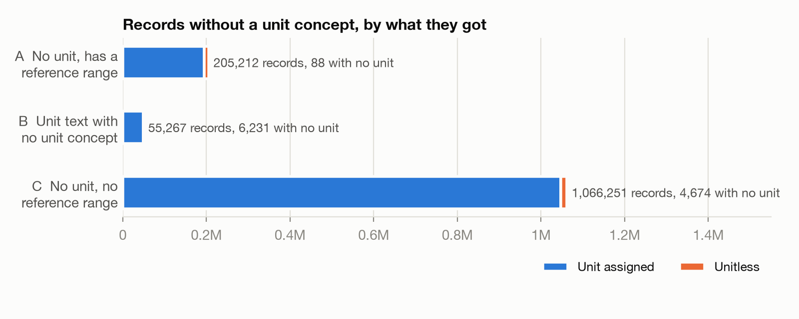
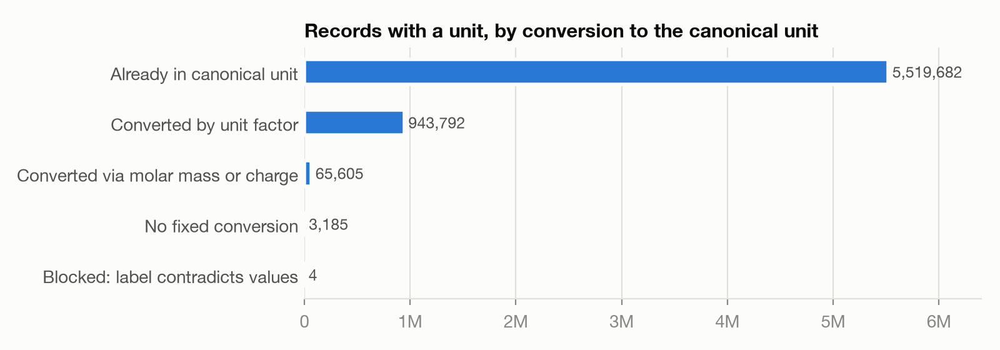

# Unit harmonization of AI-READI EHR measurements

There are 7,048,467 numeric measurement records. Three things were done to them:

1. **Missing units recovered.** 1,326,730 records (18.8%) had no unit.
   1,291,292 of those (97.3%) now have one:

   | What the 1,326,730 records with no unit have now | Records | Share |
   |---|---:|---:|
   | A unit, inferred from other records of the same test or from rules | 1,291,292 | 97.3% |
   | Marked unitless: no UCUM unit exists (specific gravity, counts, Ct values) | 24,445 | 1.8% |
   | Still no unit | 10,993 | 0.8% |

2. **Values converted to one unit per test.** Every record with a unit,
   whether it came with the record or was inferred, was converted to its
   test's canonical unit (for example, all body weights in kg).

3. **One test concept corrected.** 6,464 records filed as "Cholesterol in
   HDL/Cholesterol.total" (concept 3023884) hold total/HDL, and are
   treated as "Cholesterol.total/Cholesterol in HDL" (3011163). See
   [Records under the wrong concept](#records-under-the-wrong-concept).

The results are in
`hive_metastore.ehr_union_clean_metrics.measurement_unit_harmonized`, a full
copy of `ehr_union_clean.measurement` with added columns; the source table is
unchanged.

| Where all 7,048,467 numeric records ended up | Records | Share |
|---|---:|---:|
| In the test's canonical unit | 7,008,376 | 99.4% |
| Unitless (specific gravity, counts, Ct values) | 24,445 | 0.35% |
| Unit, but no conversion to the canonical unit | 4,653 | 0.07% |
| No unit | 10,993 | 0.16% |

## How each record's unit was decided

Every numeric record's `unit_inference_method` says how its unit was
decided. Part is the group a record fell into (below).

| Outcome | `unit_inference_method` | Part | How | Records |
|---|---|---|---|---:|
| Unit | copied_from_unit_concept_id | | Arrived with a unit concept; copied into the inferred columns | 5,721,737 |
| Unit | explicit | C | Rule on the test name (end-tidal CO2 in mm[Hg], tidal volume in mL, pain and other scores in [score], pH) | 971,623 |
| Unit | dataset_unit | A | Copied from labeled records of the same test, any partner | 157,290 |
| Unit | partner_unit, dataset_unit | C | Copied from labeled records of the same test, same partner first; medians must agree within a factor of 2 | 74,361 |
| Unit | mapped_string | B | Unit text mapped by hand to a standard unit ({ratio}, Index and S/CO included) | 49,019 |
| Unit | explicit | A | Set by hand per test (including pH, INR and ratios in {ratio}) | 22,917 |
| Unit | range_match | A | Copied from labeled records of the same test, same partner and same reference range | 14,064 |
| Unit | source_name | A | No test concept; unit from the source test name | 1,033 |
| Unit | source_name | C | No test concept; unit from the source test name | 469 |
| Unit | value_split | C | Test holds two units; each record's unit set by its value (body temperature under 45 is °C, over 80 is °F) | 340 |
| Unit | partner_unit | A | Copied from labeled records of the same test, same partner | 160 |
| Unit | reused_mapping | B | Same unit text already maps to a unit elsewhere in the table | 16 |
| Unitless | unitless | C | Rule on the test name (counts, Ct values, RAST class) | 14,784 |
| Unitless | unitless | A | Specific gravity | 9,660 |
| Unitless | unitless | B | Unit text ACTIVITY COEFF | 1 |
| No unit | unmapped_string | B | Unit text left unmapped on purpose (log viral loads, per-ejaculate counts) | 5,956 |
| No unit | not_a_quantity | C | Codes and IDs stored as numbers (EKG impression codes, HLA alleles, case numbers) | 3,790 |
| No unit | needs_review | C | No rule yet | 659 |
| No unit | not_a_unit | B | Junk in the unit field ("Possible", "PharmD") | 275 |
| No unit | suspect_concept | C | Values don't fit the test (total lung capacity stored under RV/TLC) | 225 |
| No unit | suspect_concept | A | Values don't fit the test; likely a concept-mapping error | 82 |
| No unit | needs_review | A | Undetermined | 4 |
| No unit | no_concept | A | No test concept and no source-name rule | 2 |

Unitless is only for quantities UCUM has no unit for. Ratios, pH,
indexes, scores, fractions, multiples of the median and optical density
have UCUM units (`{ratio}`, `pH`, `{index}`, `[score]`, `{fraction}`,
`{MOM}`, `{ISR}`, `[OD'U]`), and get them.

Records with no unit concept fell into three groups, handled in order:

- **A. No unit, but a reference range** (205,212). Mostly copied from labeled
  records of the same test, accepted only if the medians agree within a factor
  of 2 (which keeps 98 °F from being called Celsius); an exact reference-range
  match is trusted as is.
- **B. Unit text with no unit concept** (55,267). 223 distinct strings: 146
  map to standard units (nine spellings of the eGFR unit alone; {ratio},
  Index and S/CO among them), 1 is unitless, 18 are junk ("Possible",
  "PharmD"), and 58 are left unmapped on purpose (log viral loads,
  per-ejaculate counts).
- **C. No unit, no reference range** (1,066,251), almost all flowsheet and
  exam data from one partner. About 100 tests cover 97% of it, mostly with no
  labeled records to copy from, so units come from rules on the test name
  (end-tidal CO2 in mm[Hg], tidal volume in mL, pain scores in [score]).

Some tests needed more than a unit:

- **Body temperature** recorded in both °C and °F within one group: split by
  value (under 45 is °C, over 80 is °F).
- **Body weight**: one partner's "lb" records are ounces (median 2,847 = 80.7
  kg), and another records weight in "fluid ounces". Both convert to kg, with
  medians of 80-90 kg across partners.

## Records under the wrong concept

Every record keeps the `measurement_concept_id` it arrived with. A new
column, `harmonized_measurement_concept_id`, holds the concept the
harmonization uses: the same one, except where the
`measurement_concept_corrections` table replaces it. All units, canonical
units and conversions are per harmonized concept. There is one correction:

- **3023884 "Cholesterol in HDL/Cholesterol.total [Mass Ratio]" is
  total/HDL, now 3011163 "Cholesterol.total/Cholesterol in HDL".** All
  6,464 records are partner 3058's. HDL/total can't exceed 1, and these
  run from 1.5 to 34.3 (median 3.5). Probe F4 compared each record with
  the same person's same-day total cholesterol and HDL: 6,454 of the 6,457
  records without a reference range equal total/HDL within 10%, as do 5 of
  the 6 with one, and the one that arrived with a unit (labeled mg/dL,
  value 4.0 against a same-day total/HDL of 4.03). The other 4 have no
  same-day lipids to compare with. Partner 2084 files the same ratio
  under 3011163 (384 of its records that arrived with a unit match
  total/HDL the same way), and partner 3058's concept-0 "Cholesterol/HDL
  Ratio" records match it too. A check (Part A, 1e) flags any corrected
  record at or below 1, which could not be total/HDL; F4 found none.

## Conversion to a canonical unit

Each test gets one canonical unit, its most common unit unless set by hand
(body weight kg, height cm, temperature °C, HbA1c %). Units convert by fixed
factors (lb to kg, °F to °C, mg/L to mg/dL), and by molar mass or ionic
charge where the analyte is known (mEq/L to mmol/L for sodium, potassium,
chloride and bicarbonate). Mislabeled units were found by comparing converted
medians with those of records already in the canonical unit (seconds coded as
siemens, CEA in "mg/dL" that is ng/mL).

## Not resolved

- **10,993 records with no unit**: Part B strings left unmapped (5,956), codes
  and identifiers stored as numbers (3,790), small tests with no rule yet
  (665), the flagged records below (307), and junk unit text (275).
- **4,653 records with a unit that can't convert**: arbitrary antibody units,
  log viral loads, tests holding two different quantities (1,440 PT values
  in seconds under the INR concept, whose canonical unit is {ratio}).
- **Records stored twice** by partner 2084, under unit codes that differ
  only in case: the PT-in-seconds records above (`s` and `S`, 720 each) and
  expiratory minute volume (`L` and `l`, 869 each). Probe F6 in
  [F_probes.sql](F_probes.sql) matches them by person, time and value. They
  are left as they arrived.
- **Values that don't fit their test**, flagged and not converted (307
  records): for example "total T4" that is free T4, and total lung capacity
  stored under the RV/TLC ratio. Also noted but left as recorded: RBC counts
  under reticulocytes.

## Setup and running

Needs read access to `ehr_union_clean.measurement` and `omop_vocab.concept`,
and write access to `hive_metastore.ehr_union_clean_metrics`.

1. Import the `.sql` files below (Workspace > Import > File). They are
   in Databricks source format, so each splits into its cells on import.
2. If `measurement_unit_harmonized` already exists from an earlier version,
   drop it first (the commented-out `DROP TABLE` line in A's cell 1). A's
   `CREATE TABLE IF NOT EXISTS` doesn't add columns to an existing table,
   and earlier versions lack `harmonized_measurement_concept_id`,
   `unit_inference_method` and `unit_conversion_method`.
3. Run A, B, C and D in order, each top to bottom. Each part clears D's
   columns on the records it writes, so rerunning any part means rerunning
   D after it.
4. Run E. Every cell marked "Check" should return no rows, and every review
   should match the expectation in its comment.

The notebooks are in Databricks under
[/Shared/vital-lab-results-missingunits](https://adb-7791682337464088.8.azuredatabricks.net/editor/folders/workspace?o=7791682337464088),
imported from these files:

| Notebook | Source |
|---|---|
| A. No unit, reference range | [A_unit_inference_range_groups.sql](A_unit_inference_range_groups.sql) |
| B. Unit text, no unit concept | [B_unit_inference_with_source_value_but_no_unit_concept.sql](B_unit_inference_with_source_value_but_no_unit_concept.sql) |
| C. No unit, no reference range | [C_unit_inference_no_unit_no_range.sql](C_unit_inference_no_unit_no_range.sql) |
| D. Conversion to canonical units | [D_unit_conversion.sql](D_unit_conversion.sql) |
| E. Checks and review of the run | [E_review_outputs.sql](E_review_outputs.sql) |
| F. Probes for review questions (optional) | [F_probes.sql](F_probes.sql) |

Part A's first cells create the target table if it doesn't exist, fill
the inferred columns for records that arrived with a unit, and fill
`harmonized_measurement_concept_id`. Columns added to
`ehr_union_clean.measurement`'s, and the numeric records each is empty for:

| Column | Type | Contents | Empty for |
|---|---|---|---|
| `harmonized_measurement_concept_id` | bigint | The test: `measurement_concept_id`, or its correction ([above](#records-under-the-wrong-concept)); 0 where there is none | none |
| `unit_inference_method` | string | How the unit was decided (table above) | none |
| `inferred_unit_concept_id` | bigint | The record's unit: inferred, or copied from `unit_concept_id` | unitless, no unit |
| `inferred_unit_source_value` | string | That unit's UCUM code | unitless, no unit |
| `canonical_unit_concept_id` | bigint | The test's canonical unit, set where `harmonized_value_as_number` is in it | unitless, no unit, no conversion |
| `canonical_unit_value` | string | The canonical unit's UCUM code | unitless, no unit, no conversion |
| `harmonized_value_as_number` | double | Value in the canonical unit; for unitless records, the value as recorded | no unit, no conversion |
| `unit_conversion_method` | string | `identity` (already in the canonical unit), `same_base` (unit factors), `analyte_bridge` (molar mass or charge), `no_conversion`, `blocked` | unitless, no unit |

The 786,850 records with no numeric value get
`harmonized_measurement_concept_id`, plus the method and inferred unit
when they arrived with a unit concept; the last four columns stay empty. Check E3 confirms
that no numeric record with a unit is missing one of its columns.

Open items and the state of the work are in
[unit_inference_handoff.md](unit_inference_handoff.md); the earlier
exploration queries are in [exploration_queries.md](exploration_queries.md).

Every rule is a table in `ehr_union_clean_metrics` and every record carries
`unit_inference_method`, so any assigned unit can be traced to the rule that
set it. Notebook E holds the checks (all pass) and the reviews behind the
numbers above.
